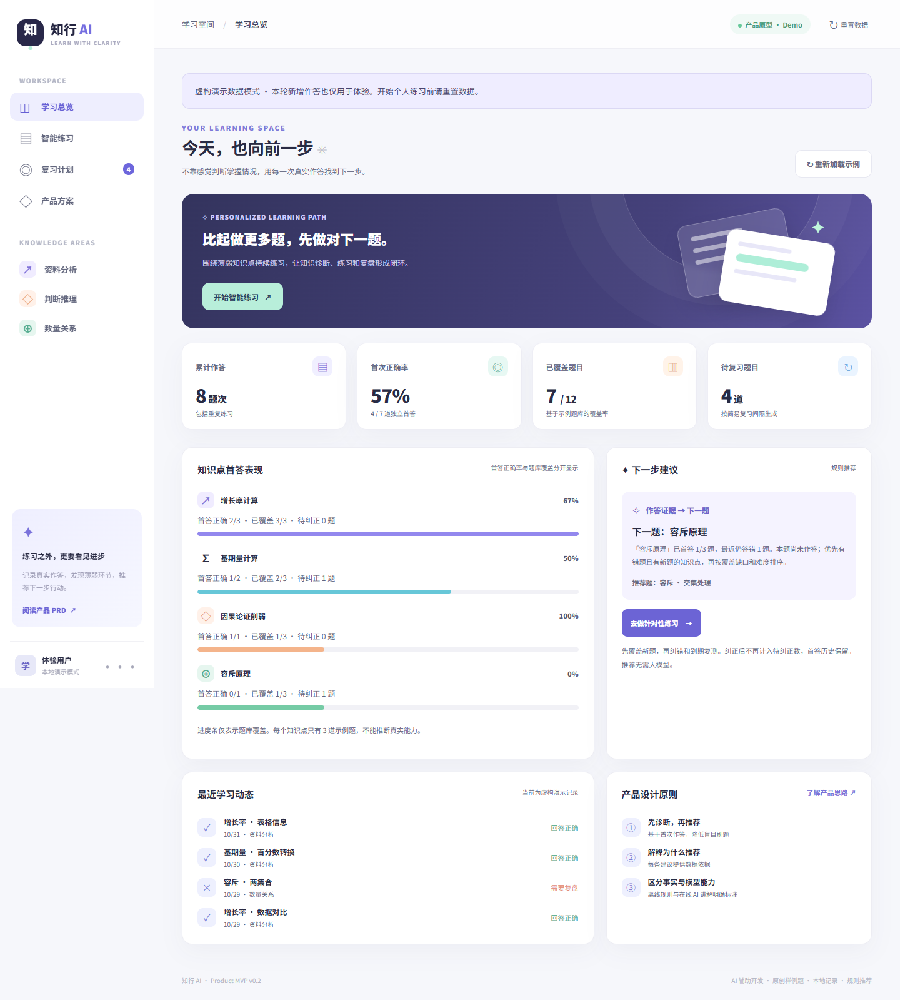

# 知行 AI · 个性化学习助手

> 把「做错之后不知道下一题练什么」变成一条可解释、可复测的学习路径。
>
> **求职作品原型 v0.2 · AI 辅助开发 · 12 道原创样例题 · 无真实用户或提分数据**
>
> **[打开在线演示](https://coogif.github.io/zhixing-ai-study-copilot/)** · [GitHub 仓库](https://github.com/Coogif/zhixing-ai-study-copilot) · [上线验收记录](docs/PUBLICATION.md)



## 先看什么

| 招聘人员想了解 | 入口 |
|---|---|
| 90 秒了解问题、价值与取舍 | [产品案例](docs/CASE_STUDY.md) |
| 亲自体验学习闭环 | 双击 `preview.html`，或运行下方本地服务 |
| 查看需求、用户故事、优先级 | [PRD](docs/PRD.md) · [用户故事](docs/USER_STORIES.md) |
| 理解推荐与 AI 的边界 | [设计决策及 AI 评估](docs/DECISIONS.md) |
| 核对质量与限制 | [最终验收](docs/ACCEPTANCE.md) · [分阶段审查记录](docs/AUDIT.md) |
| 准备演示和面试 | [演示脚本](docs/DEMO.md) · [贡献与署名](docs/CONTRIBUTIONS.md) |

## 用户问题与闭环

初始问题来自个人学习情境：学过理论，实际做题仍会混淆公式或推理关系；看完对错反馈后，仍不知道下一步练什么。**这是待验证的观察，尚未开展用户访谈。** 目标用户暂定为已完成一轮基础学习、需要针对性巩固的自学者。

**独立作答 → 保留首答证据 → 解释下一题依据 → 查看解析并自评 → 错题或到期复测 → 更新当前错题状态。**

默认所有记录只存当前浏览器，演示数据全程标注为虚构；进入演示模式后的新增作答也只用于体验。开始个人练习前应重置。

## 已实现什么

- 4 个知识点 × 3 道示例题，提交前不显示答案与公式卡。
- 总览分别展示首答正确率、题库覆盖及待纠正题数；小样本不作能力结论。
- 可解释的规则推荐：优先有新题的知识点，用当前未纠正错题数与覆盖缺口排序，题内优先低难度；新题用尽后纠错和到期复测。
- 同题复测保留首答，按最近答案更新错题状态；错 1 天、对 3 天的固定复习间隔。
- 可选错因自评与预写解析有用性反馈，只在本机保存。
- 可选的本地大模型接口、离线单文件、静态发布构建、自动化检查与真实浏览器截图。

| 功能 | 实际实现 | 边界 |
|---|---|---|
| 推荐与复习 | 确定性规则 | 不属于机器学习或大模型推理 |
| 答案与方法卡 | AI 辅助整理的预写内容 | 尚未经独立教育专家审核 |
| 错因标签 | 用户主动自评 | 不是模型诊断，不参与推荐排序 |
| 模型延伸讲解 | 本地服务调用 OpenAI Responses API | 可选；本次未进行真实模型调用或效果评测 |
| 数据 | 浏览器 `localStorage` | 无账户、云同步、跨设备与云端分析 |
| 验证 | 工程测试、模拟数据与浏览器流程 | 没有用户增长、留存、提分或统计显著性结果 |

## 运行与测试

最快方式：双击根目录 **`preview.html`**。核心功能不需要网络或 API Key。离线版与 HTTP 版属于不同存储范围，记录不会互通。

本地服务需要 **Node.js 22+（建议 24 LTS）**，无需安装运行时第三方依赖：

```bash
node scripts/dev-server.mjs
```

访问 `http://127.0.0.1:4173`。也可使用 `npm run dev`。

```bash
node scripts/check.mjs          # 语法、规则、存储及接口单元检查
node scripts/build-preview.mjs  # 更新离线版；改源码后需要重新生成
node scripts/build-pages.mjs    # 输出静态白名单文件到 dist/
```

完整浏览器测试和截图需要测试依赖。仓库以 `pnpm-lock.yaml` 锁定依赖：

```bash
corepack enable
corepack prepare pnpm@11.25.0 --activate
pnpm install --frozen-lockfile
pnpm exec playwright install chromium
pnpm test:e2e
pnpm screenshots
```

Windows 浏览器测试使用已安装的 Microsoft Edge；Linux/CI 使用 Playwright Chromium。测试使用隔离浏览器上下文，不读取个人浏览器历史或学习记录。详细说明和本次实际命令见 [TESTING](docs/TESTING.md)。

## 可选：本地模型讲解

公开静态版和离线版明确显示「模型讲解未启用」。统计、推荐和预写解析均正常工作。

仅在受控本机 PowerShell 中设置环境变量并启动服务：

```powershell
$env:OPENAI_API_KEY="你的密钥"
$env:OPENAI_MODEL="gpt-4.1-mini"
node scripts/dev-server.mjs
```

`.env.example` 是格式参考，服务不会自动读取 `.env`。不要在页面、URL、GitHub Secrets 或 Pages 中放入模型 Key。点击讲解按钮前页面会说明：仅向 OpenAI 发送当前题目、所选选项和预写答案，不发送整段学习历史或自评反馈。模型可能出错，需要人工核对。

本机服务限制 loopback Host、同源 JSON、输入大小、18 秒超时、单并发和每分钟 10 次；这些不是生产鉴权体系。不要将此开发服务暴露到公网。模型质量是否值得付费调用，按 [评估方案](docs/DECISIONS.md) 验证后决定。

## 工程与发布

```text
src/                    页面交互、题库、规则引擎、存储校验
api/coach.mjs           可选本地模型接口，不进入 Pages 产物
scripts/                本地服务、离线生成、静态构建、检查与截图
tests/                 单元及浏览器回归测试
docs/                  产品、验证与发布材料
assets/                真实界面截图及截图来源记录
.github/workflows/      检查与受测试约束的 Pages 发布
```

[发布步骤](docs/PUBLISH.md) 采用独立新仓库及 GitHub Actions，仅部署 `dist/`。当前项目已发布到独立公开仓库，GitHub Actions 检查通过后部署；没有访问或修改其他仓库。`package.json` 中 `private: true` 只防止误发布到 npm，与 GitHub 仓库可见性无关。

## 局限与署名

题量少、同题记忆效应明显，规则与复习间隔都未经教育效果实验；预写内容尚未经独立专家审核。尚未验证 Safari、真实屏幕阅读器及真实模型质量；公网 Pages 已通过线上冒烟验收。推荐曝光/转化埋点、授权真题、账户同步与知识追踪模型均未实现，规划见 [版本路线](docs/ROADMAP.md)。

这是 **AI 辅助开发和整理文档的个人产品探索原型**。不能将代码写成独立手写，也不能将文档中的候选设计自动视为本人独立完成、亲自验证的成果。请按 [贡献说明](docs/CONTRIBUTIONS.md) 补充自己真实参与的决策、演示和测试。
