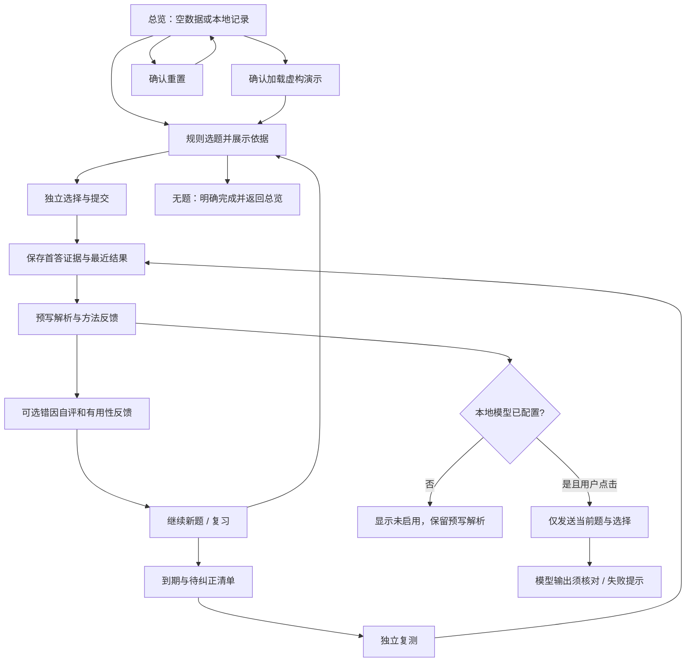

# 产品流程与异常路径

| 触发 | 行为 |
|---|---|
| 未选选项、重复提交 | 未选不可提交；提交后选项锁定，按钮变为下一题 |
| 切换题目或页面 | 当前未提交选择可丢弃，已提交历史保留；回退/刷新使用 hash |
| 无待复习 | 显示本轮结束，不借用普通练习题填充 |
| 存储损坏 | 丢弃非法记录；格式无法读取时提示；继续内存练习 |
| 存储禁止或配额满 | 提示刷新可能丢失；无法删除时提示旧记录可能恢复 |
| AI 旧请求晚返回 | 按作答轮次隔离，不能覆盖同题后续提交 |
| 加载演示或清空 | 在产品内再次确认；取消不改变记录 |

数据边界：HTTP 不同端口、不同域名及 file:// 可能属于不同存储范围。静态站点上同域的其他脚本也可能读取本地存储，因此不应在本产品中录入敏感个人信息。当前只提供固定枚举反馈。
